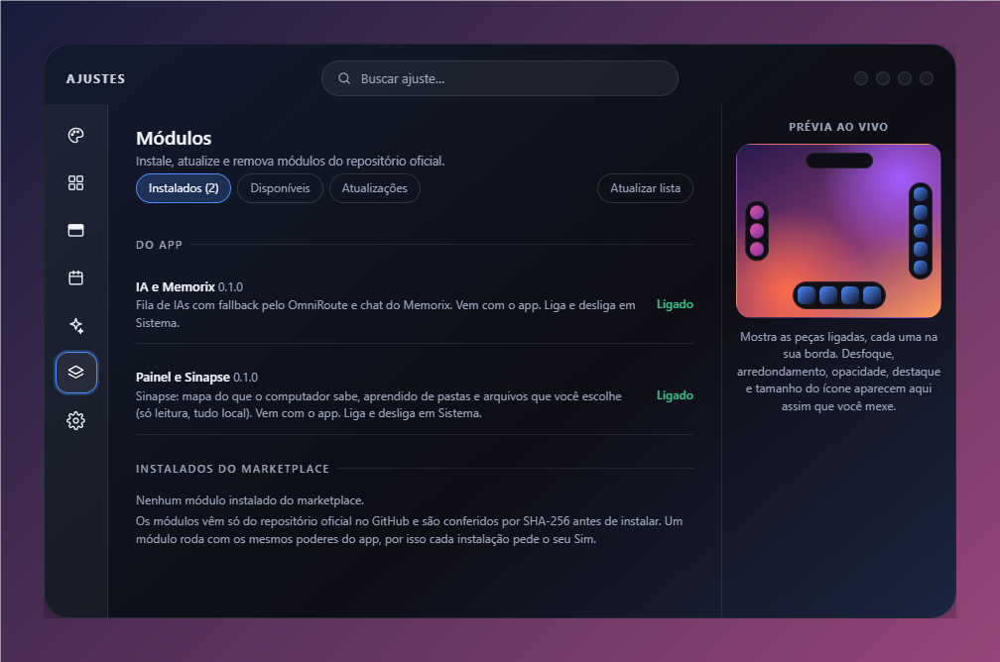
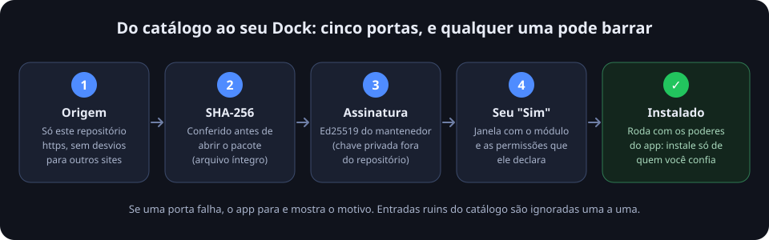

# Memoritrix Dock — Marketplace

Catálogo e pacotes dos **módulos** do [Memoritrix Dock](https://github.com/Jampierry/Memoritrix---Dock).

O Memoritrix Dock é um núcleo pequeno (dock, ilha, calendário, mídia, tarefas) com módulos que acrescentam recursos. Dois vêm no app (**IA e Memorix** e **Painel e Sinapse**). Todo o resto, inclusive os módulos feitos por você, vem **deste repositório**.



## Em uma olhada

| Quero… | Vá para |
|---|---|
| Instalar um módulo no meu Dock | [Como usar o marketplace](docs/como-usar.md) |
| Instalar skills e plugins públicos do Claude | [Skills e plugins do Claude](docs/skills-e-plugins-do-claude.md) |
| Criar um módulo | [Criar um módulo](docs/criar-um-modulo.md) |
| Publicar o meu módulo aqui | [Publicar no marketplace](docs/publicar.md) |
| Entender por que é seguro (e onde não é) | [Catálogo e segurança](docs/catalogo-e-seguranca.md) |
| Ver um módulo funcionando para copiar | [`exemplos/ola-dock`](exemplos/ola-dock) |
| Ler o código dos módulos que vêm no app (`ia`, `painel`, `claude`) | [`modulos-do-app`](modulos-do-app) |
| Usar o Graphify (mapa do projeto) no Claude e nos assistentes do app | [Graphify](docs/graphify.md) |

## O que há neste repositório

```
marketplace.json        o catálogo de módulos que o app lê (cada entrada é assinada)
claude-catalogo.json    o catálogo de skills e plugins do Claude (cada item é assinado)
claude-catalogo.fonte.json   a fonte editável desse catálogo (o app não lê)
pacotes/                os módulos, um .zip por versão: <id>-<versão>.zip
exemplos/               código-fonte de módulos de exemplo
modulos-do-app/         fontes dos módulos que vêm no app (para leitura; não se instalam daqui)
docs/                   manuais e imagens
```

- O app lê `https://raw.githubusercontent.com/Jampierry/Memoritrix-Dock-Marketplace/main/marketplace.json`.
- Cada pacote é baixado de `pacotes/` desta mesma branch `main`.
- Este repositório é **somente do marketplace** e precisa continuar **público**: assim o app lê sem login. O código do app fica em outro repositório.

## Módulos que vêm no app

O app traz três módulos próprios, cujas fontes estão em [`modulos-do-app`](modulos-do-app): **IA e Memorix**, **Painel e Sinapse** e **Skills e plugins do Claude**. Eles não se instalam por aqui (os ids são reservados), mas o código fica aberto para estudo.

## Módulos disponíveis

| Módulo | Versão | O que faz | Pede |
|---|---|---|---|
| **Olá, Dock** (`ola-dock`) | 1.0.0 | Exemplo mínimo: mostra que instalar, confirmar permissões e ativar funcionam | dados no app (`config`) |

A lista que vale é a do próprio app (**Ajustes > Módulos > Disponíveis**), que já mostra a situação de cada módulo: disponível, instalado, com atualização ou incompatível com a sua versão do Dock.

## Skills e plugins do Claude

Um segundo catálogo, `claude-catalogo.json`, traz **17 skills** e **12 plugins** públicos do Claude, aprovados e assinados. Em **Ajustes > Skills e plugins do Claude** há um botão para instalar cada um no **Claude Code** (sua pasta `~/.claude`) ou no **projeto aberto no VS Code** (`.claude` do projeto). Detalhes em [Skills e plugins do Claude](docs/skills-e-plugins-do-claude.md).

## Como o app confia no que baixa

1. **Origem:** só aceita pacotes deste repositório (`raw.githubusercontent.com` ou as Releases daqui). Qualquer outro endereço é recusado.
2. **SHA-256** do arquivo, conferido **antes de abrir** o pacote.
3. **Assinatura Ed25519** de cada entrada do catálogo. Sem assinatura válida, a entrada nem aparece. Quem só consegue escrever neste repositório não consegue trocar um pacote por outro.
4. **A sua confirmação** numa janela que lista o que o módulo declara que faz.



> **Atenção:** um módulo roda com **os mesmos poderes do app** no seu computador (arquivos e internet). As permissões do manifesto são a **declaração** do autor, **não um bloqueio**. Instale só de quem você confia. Detalhes em [Catálogo e segurança](docs/catalogo-e-seguranca.md).

## Contribuir

Para ter um módulo aqui, ele precisa ser **assinado pela chave do mantenedor**: o app só aceita entradas com essa assinatura. Abra uma *issue* descrevendo o módulo, as permissões que ele pede e o código-fonte. Depois da revisão, o mantenedor empacota, assina e publica. O passo a passo está em [Publicar no marketplace](docs/publicar.md).

## Licença

Cada módulo tem a licença do seu autor, declarada no código ou no `README` dele. Este repositório ainda não define uma licença própria para o catálogo.
