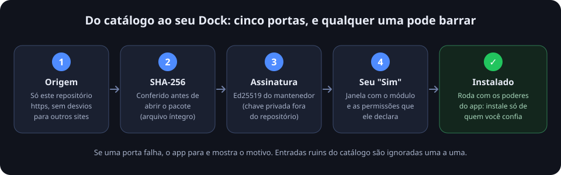

# Catálogo e segurança

Como o `marketplace.json` é montado, como o app o valida e o que a segurança **protege e não protege**.

## O catálogo (`marketplace.json`)

```json
{
  "modulos": [
    {
      "id": "ola-dock",
      "nome": "Olá, Dock (exemplo)",
      "descricao": "O que o módulo faz.",
      "versao": "1.0.0",
      "pacote": "https://raw.githubusercontent.com/Jampierry/Memoritrix-Dock-Marketplace/main/pacotes/ola-dock-1.0.0.zip",
      "sha256": "<64 caracteres hexadecimais>",
      "permissoes": ["config"],
      "dockMinima": "0.1.0",
      "tamanho": 750,
      "assinatura": "<Ed25519 em base64>"
    }
  ]
}
```

| Campo | Regra |
|---|---|
| `id` | `^[a-z][a-z0-9-]{0,31}$`; único no catálogo; `ia` e `painel` são reservados |
| `nome` | obrigatório |
| `descricao` | texto livre |
| `versao`, `dockMinima` | semver `x.y.z` |
| `pacote` | `https://raw.githubusercontent.com/Jampierry/Memoritrix-Dock-Marketplace/main/pacotes/<arquivo>.zip` ou `https://github.com/Jampierry/Memoritrix-Dock-Marketplace/releases/download/<tag>/<arquivo>.zip` |
| `sha256` | 64 caracteres hexadecimais, do `.zip` exato |
| `permissoes` | só valores de `rede`, `arquivos`, `abrir-itens`, `ia`, `config`, `janelas`, `notificacoes` |
| `tamanho` | opcional, em bytes (só informativo) |
| `assinatura` | Ed25519 (64 bytes em base64) sobre `id`, `versao`, `sha256` e `pacote` |

Você **não escreve esse arquivo à mão**: o `publicar-modulo.mjs` gera as entradas, calcula o SHA-256 e assina. Veja [Publicar no marketplace](publicar.md).

## A cadeia de confiança



1. **O app só baixa deste repositório.** Os endereços aceitos são `raw.githubusercontent.com/…/main/pacotes/` e as Releases deste repositório. É `https`, sem usuário, sem porta, sem `..`. Os redirecionamentos são conferidos de novo, e só hosts do GitHub são aceitos. O download tem tempo e tamanho limitados (catálogo até 512 KB, pacote até 25 MB).
2. **O SHA-256 é conferido antes de abrir o pacote.** Se não bater com o do catálogo, nada é extraído.
3. **A assinatura prova quem aprovou.** O SHA-256 sozinho só prova que o arquivo é o que o catálogo diz, e quem escreve no repositório poderia trocar os dois. A assinatura Ed25519 só pode ser feita com a **chave privada**, que **não está no repositório**. A chave pública vem dentro do app.
4. **Você confirma.** Uma janela lista o módulo e as permissões; só o seu "Sim" continua.
5. **Ids do app são protegidos.** `ia` e `painel` não podem ser instalados nem substituídos.

## Por que uma entrada é ignorada

O app valida **cada entrada separadamente**: uma entrada ruim não derruba as outras. A aba **Disponíveis** avisa quantas foram ignoradas. Os motivos possíveis:

| Motivo | O que está errado |
|---|---|
| `id inválido` / `id reservado do app` / `id repetido` | Fora do padrão, é `ia` ou `painel`, ou aparece duas vezes |
| `sem nome` | Falta `nome` |
| `versão inválida` / `dockMinima inválida` | Não é `x.y.z` |
| `sha256 inválido` | Não tem 64 caracteres hexadecimais |
| `pacote fora do repositório oficial do marketplace` | O endereço não é deste repositório |
| `assinatura ausente ou inválida` | Não foi assinada com a chave do mantenedor, ou algum campo mudou depois de assinar |
| `permissões inválidas` | Há uma permissão que não existe, ou a lista está ausente |

> Mudar **qualquer** campo assinado (`id`, `versao`, `sha256`, `pacote`) à mão invalida a assinatura. Sempre republique pelo script.

## O que isso protege, e o que não protege

**Protege contra**

- Alguém com acesso de escrita ao repositório trocar um pacote por outro (a assinatura não bate).
- Um pacote corrompido ou adulterado no caminho (o SHA-256 não bate).
- Um catálogo que aponte para um servidor qualquer (a origem é recusada).
- Um módulo que tente tomar o lugar de `ia` ou `painel`.
- Instalação sem o seu consentimento (a confirmação é obrigatória).

**Não protege contra**

- **Um módulo legítimo e assinado que faça algo ruim.** Um módulo roda com **os mesmos poderes do app** no seu computador. As permissões do manifesto são a **declaração** do autor, **não uma sandbox**. Instale só de quem você confia.
- **Perda da chave privada.** Quem a tiver assina módulos que o app aceita. Se ela vazar, é preciso gerar outro par e lançar uma nova versão do app com a nova chave pública.
- **Retirar um módulo já instalado.** Tirar a entrada do catálogo não remove o módulo dos computadores onde ele já está.

## Privacidade

O app só faz **duas coisas de rede** com o marketplace: baixar o `marketplace.json` e, se você instalar, baixar o `.zip`. Nada seu é enviado. O repositório é público e o app lê sem login.

Veja também a [segurança do app](https://github.com/Jampierry/Memoritrix---Dock/blob/main/docs/seguranca-e-privacidade.md).
