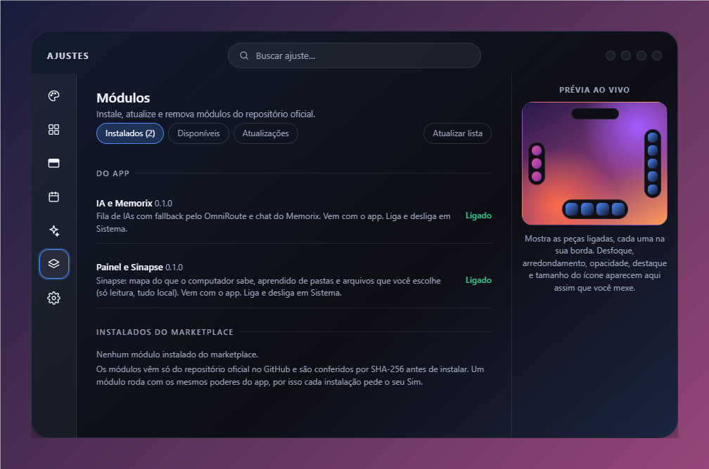
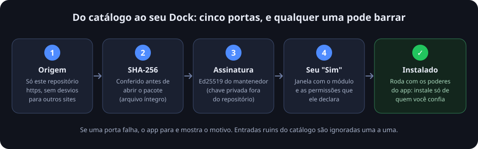

# Como usar o marketplace

Guia de quem **usa** o Memoritrix Dock. Para criar módulos, veja [Criar um módulo](criar-um-modulo.md).

## Onde fica

No Memoritrix Dock, abra **Ajustes > Módulos** (o ícone de camadas na barra lateral dos Ajustes).

A tela tem três abas e um botão:

| Aba | O que mostra |
|---|---|
| **Instalados** | Os módulos do app (**IA e Memorix**, **Painel e Sinapse**) e os que você instalou do marketplace |
| **Disponíveis** | O catálogo deste repositório: o que ainda não está instalado, ou que pede uma versão mais nova do Dock |
| **Atualizações** | Módulos instalados que ganharam versão nova |
| **Atualizar lista** | Consulta o catálogo de novo (o app guarda a resposta por um tempo) |

## Instalar um módulo

1. Abra a aba **Disponíveis**.
2. Leia a **descrição** e a linha **"Pede:"**, que lista o que o módulo declara que faz (internet, arquivos, abrir programas e pastas, IA do Memorix, dados no app, janelas, avisos).
3. Clique em **Instalar**.
4. Uma janela de confirmação mostra o módulo e as permissões. **Só o seu "Sim" continua.** Em "Não" ou fechando a janela, nada é instalado.
5. O app baixa, confere e instala. O módulo já fica ligado e aparece em **Instalados**.

Um botão cinza **"Exige dock x.y.z"** quer dizer que o módulo precisa de uma versão do Dock mais nova que a sua.

## Ligar, desligar, atualizar, voltar e desinstalar

Na aba **Instalados**, cada módulo do marketplace tem:

- **Ligar / Desligar:** o módulo deixa de ser carregado sem ser apagado.
- **Voltar para x.y.z:** aparece depois de uma atualização. O app guarda a versão anterior para você desfazer se algo der errado.
- **Desinstalar:** remove o módulo e o que ele registrou na dock.

Na aba **Atualizações**, o botão **Atualizar** pede a sua confirmação de novo, porque as permissões podem ter mudado.

Os módulos do app (**IA e Memorix** e **Painel e Sinapse**) não podem ser substituídos nem removidos pelo marketplace. Para ligar ou desligar esses dois, use **Ajustes > Sistema**.

## O que o app confere antes de instalar

1. O pacote vem **deste repositório** e de mais lugar nenhum.
2. O **SHA-256** do arquivo bate com o do catálogo.
3. A entrada do catálogo tem uma **assinatura válida** do mantenedor.
4. Você confirma.

Se qualquer passo falhar, o app para e mostra o motivo. Entradas do catálogo que não passam na validação são **ignoradas uma a uma**, e a aba **Disponíveis** avisa quantas foram.

## Problemas comuns

| O que você vê | O que fazer |
|---|---|
| "O GitHub respondeu 404" ao consultar | O catálogo ainda não foi publicado, ou o repositório ficou privado. O repositório precisa ser público. |
| "Não consegui consultar o marketplace" | Sem internet ou GitHub fora do ar. Clique em **Tentar de novo**. |
| "(n) item(ns) do catálogo foram ignorados" | Alguma entrada está sem assinatura válida ou com campos errados. Os outros módulos continuam funcionando. |
| "Exige dock x.y.z" | Atualize o Memoritrix Dock. |
| O módulo instalou mas "Com erro" | Veja a mensagem em **Instalados**. Desligue ou desinstale o módulo e avise o autor. |

## Segurança, em uma frase

Um módulo roda com os **mesmos poderes do app** no seu computador. Instale só de quem você confia. A explicação completa está em [Catálogo e segurança](catalogo-e-seguranca.md).
