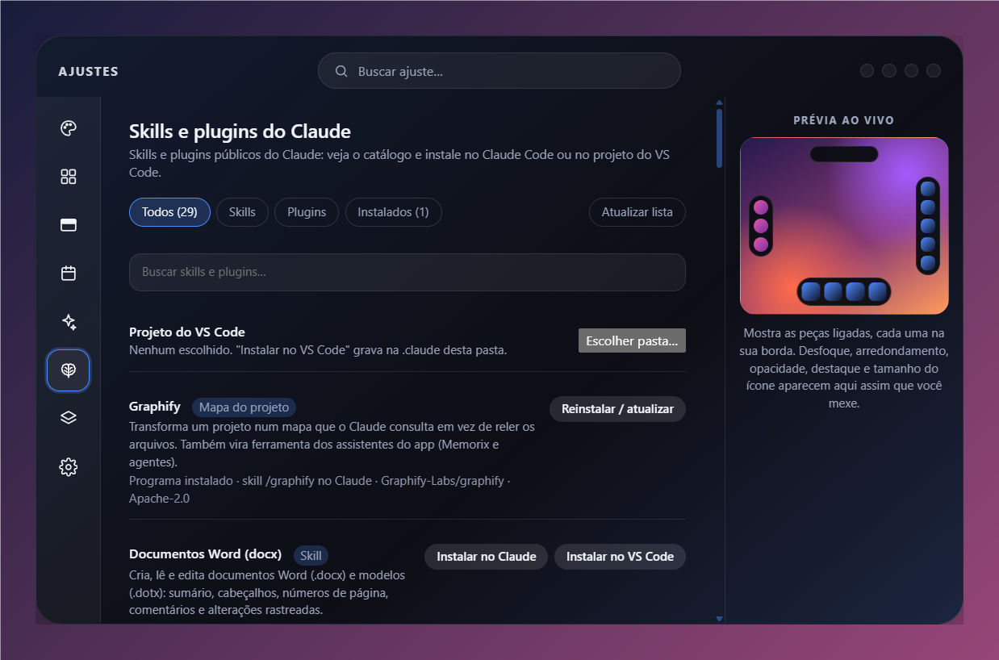

# Graphify: o mapa do projeto, no Claude e nos assistentes do app

O [Graphify](https://github.com/Graphify-Labs/graphify) (Apache-2.0, projeto independente, **não é da Anthropic**) transforma um projeto num **mapa** (pontos e ligações). Em vez de reler os arquivos a cada sessão, o Claude consulta o mapa e gasta menos tokens.

No Memoritrix Dock ele aparece de três formas:

| Onde | O que ganha |
|---|---|
| **Claude Code** (e o do VS Code) | A skill `/graphify`, instalada em `~/.claude/skills/graphify` |
| **Assistentes do app** (Memorix e os agentes) | As ferramentas `mapa_consultar` e `mapa_criar` e a habilidade **"Mapa do projeto (Graphify)"** |
| **Ajustes > Skills e plugins do Claude** | Um cartão para **instalar o Graphify** com um clique (com a sua confirmação) |

## Instalar



Pelo app: **Ajustes > Skills e plugins do Claude > Graphify > Instalar o Graphify**. A janela de confirmação mostra os dois comandos que serão rodados, nesta ordem:

```
uv tool install --force "graphifyy[mcp]"
graphify install --platform claude
```

- O pacote se chama `graphifyy` (com **dois y**); o comando é `graphify`. O extra `[mcp]` é necessário para os comandos de consulta (`query`, `explain`, `path`).
- Precisa do [uv](https://docs.astral.sh/uv/) (`winget install astral-sh.uv`). Se faltar o Python, o uv baixa sozinho.
- O `graphify install` coloca a skill em `~/.claude/skills/graphify` e cria (ou acrescenta) uma nota curta em `~/.claude/CLAUDE.md`.

Depois, **abra uma conversa nova** no Claude e digite `/graphify .` na pasta do projeto.

## Os assistentes do app

Com **"IA pode agir no app"** ligado (Ajustes > IA), cada assistente que tem ferramentas ganha duas:

| Ferramenta | O que faz | Confirmação |
|---|---|---|
| `mapa_consultar` | Consulta o mapa do projeto (`graphify-out/graph.json`) em três modos: `query` (pergunta livre), `explain` (um ponto e os vizinhos) e `path` (o caminho entre dois pontos). **Só lê.** | Não pede |
| `mapa_criar` | Cria ou atualiza o mapa com `graphify update <pasta>`: lê **só o código**, no seu computador, **sem usar IA**, e grava na pasta `graphify-out` do projeto | **Pede o seu Sim** |

Detalhes de segurança:

- Os comandos rodam **sem shell** (argumentos separados) e só numa **pasta que existe** (caminho absoluto).
- Como `mapa_consultar` lê dados locais, depois dela a **internet fica bloqueada** no mesmo pedido, como acontece depois de ler as notas da Sinapse. Assim, nada do que foi lido pode ser enviado para fora por engano.
- O resultado volta ao assistente como **dado**, nunca como ordem.

### A habilidade de nascença

Todo assistente, inclusive o Memorix, já **nasce sabendo** a habilidade **"Mapa do projeto (Graphify)"**: quando consultar o mapa em vez de ler arquivos, como criar o mapa, os três modos de consulta e que o mapa não substitui o código. Ela entra uma vez só por assistente, aparece no mapa de habilidades (`skills_habil.md` na Sinapse) e **cresce** como as outras. Se você esquecer a habilidade pelo menu do agente (Memória), ela não volta sozinha.

## Atualizar o mapa

- Depois de mudanças grandes: `/graphify . --update` no Claude, ou peça ao assistente do app para rodar `mapa_criar` de novo. Só o que mudou é relido.
- Textos, PDFs e imagens passam pelo modelo na primeira leitura (`/graphify` no Claude). O `graphify update`, usado pelo app, lê só o código.

## O que ele não faz

- O mapa **não substitui o código**: para mudar um arquivo, o assistente ainda abre esse arquivo. O mapa só diz qual abrir.
- Não aumenta o limite do plano: ajuda o limite a durar mais, porque se lê menos.
- Num projeto pequeno, a diferença é pequena.

## Problemas comuns

| O que você vê | O que fazer |
|---|---|
| "O uv não está instalado" | `winget install astral-sh.uv` e tente de novo |
| "ModuleNotFoundError: anyio" ao consultar | Faltou o extra: `uv tool install --force "graphifyy[mcp]"` (o botão do app já instala assim) |
| `/graphify` não aparece no Claude | Feche e abra o Claude; se continuar, `graphify install --platform claude` |
| "Esta pasta ainda não tem mapa" | Peça ao assistente para usar `mapa_criar`, ou rode `graphify update <pasta>` |
| "O Graphify não está instalado" (no app) | Use o botão **Instalar o Graphify** na aba Claude |
